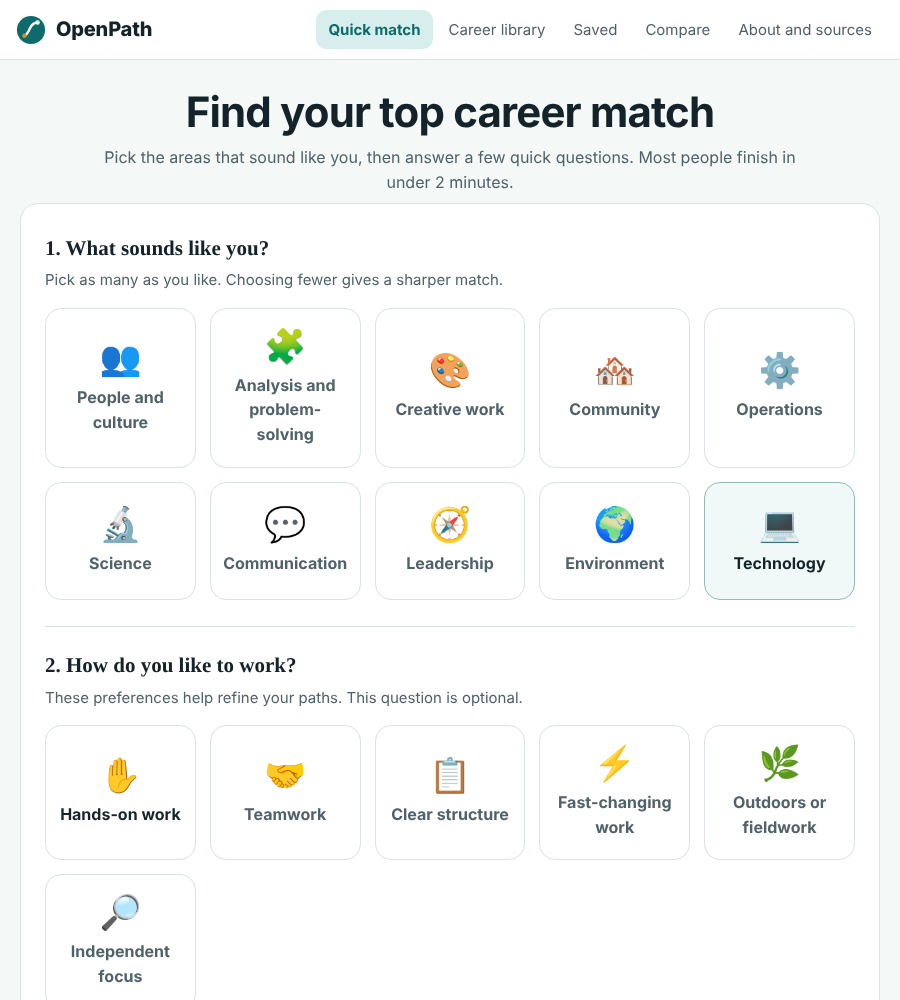
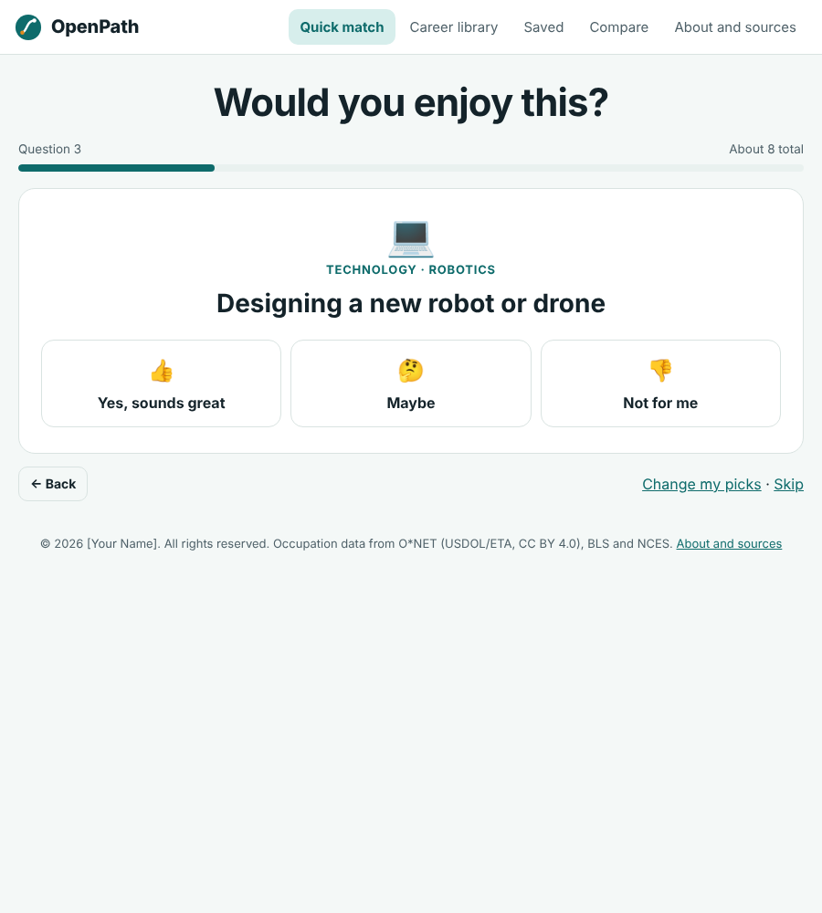
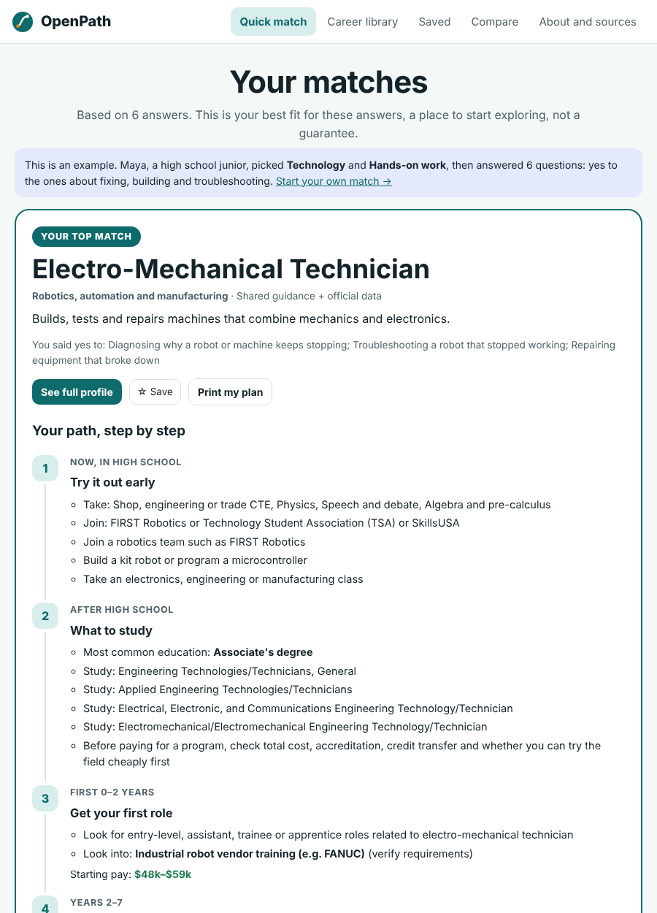
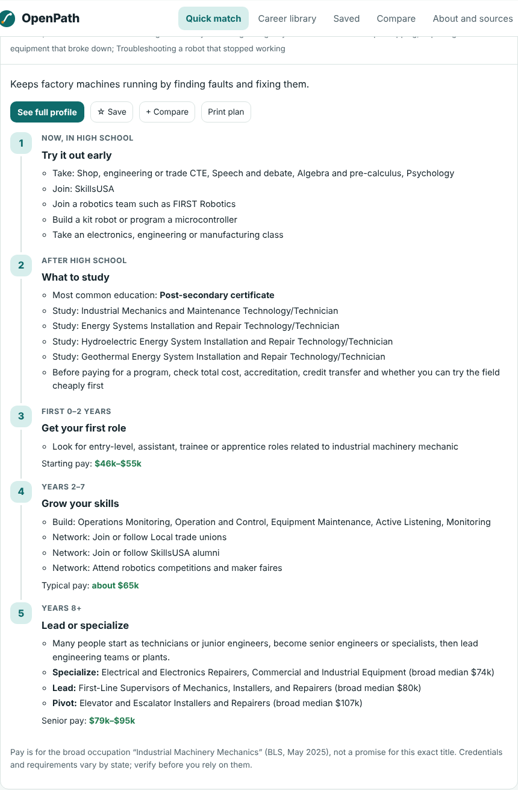
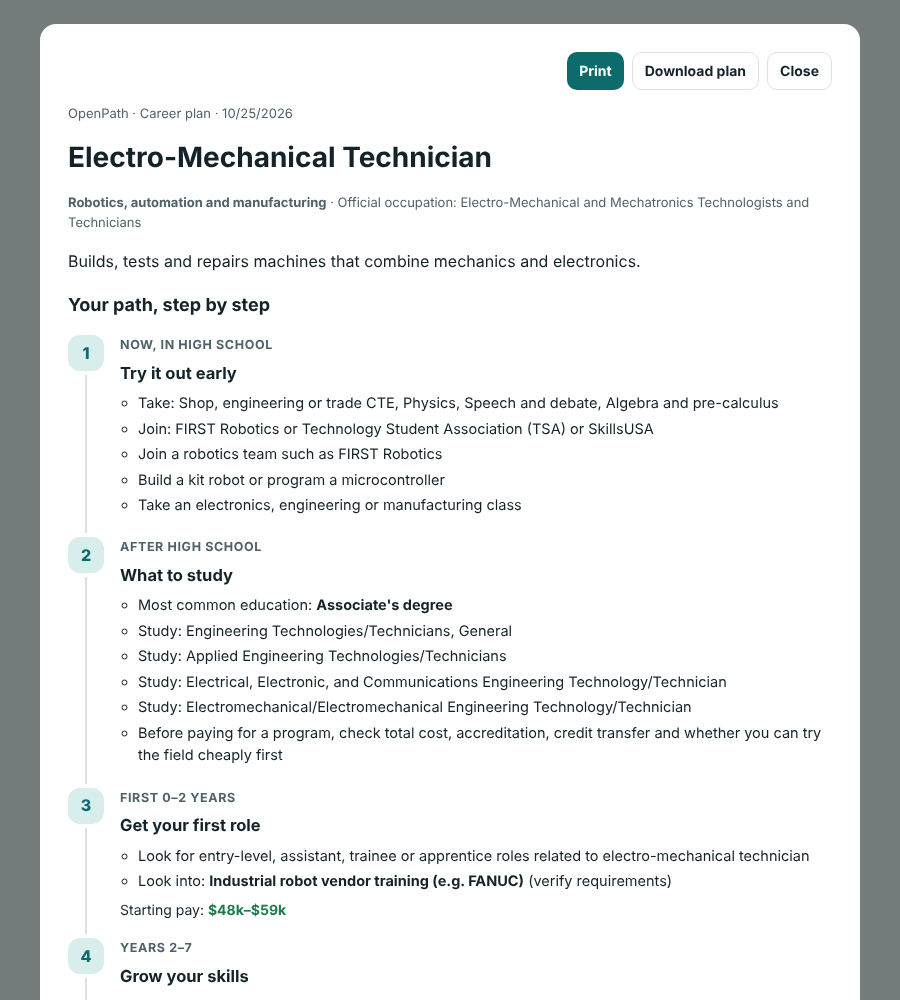

# OpenPath — career choices beyond familiar job titles

## At a glance

- **The wedge (version 1):** one school counselor, one 45-minute class period. Every junior finishes Quick match in about two minutes and leaves with a printed career plan for their counseling meeting. No accounts, server, student data or district purchase, so a counselor can run it the same day. Nothing else has to be built for this to deliver value.
- **Headline KPI:** the share of students in a class who find at least one career they hadn't heard of and want to look into. **Pilot target: 60% or more.** Not yet measured; how we'll measure it is in `PILOT.md`.
- **Proof it works today (measured):** the sample student reaches a full five-step plan in 6 answers. See it in one click: https://hackathonvanguard.vercel.app/?demo=maya

**Beyond the wedge**

- **Market:** 15.6 million U.S. public high school students (NCES, fall 2023), served by school counselors averaging 372 students each (ASCA, 2024–25). 353,310 educational, guidance and career counselors and advisors work in the U.S. (BLS, May 2025); they are the people who bring OpenPath into a classroom.
- **Impact:** 33% of bachelor's students change their major within three years (NCES). One extra semester at a public four-year college costs about $5,800 in tuition alone (College Board, 2024–25). OpenPath moves that exploration to high school, when it's free.
- **Why it gets bigger:** each counselor brings a whole class, so it spreads school by school without a sales cycle. A paid counselor view is what districts would buy. Then college career centers, all 1,016 O*NET occupations, and the AI advisor on OCI Generative AI.

## Short description

OpenPath helps students explore careers they may not know to search for yet. In about two minutes, a student picks a few interests, answers short "Would you enjoy this?" questions, and gets a top match plus five other strong matches. Each match comes with a step-by-step path: what to do now in high school, what to study, how to get a first role, how to grow, and how to lead or specialize, with pay at each stage. The first use is narrow: a high school counselor runs it in one class period, and every student leaves with a printable plan to bring to their counseling meeting.

## Before and after

| Step | Today | With OpenPath |
|---|---|---|
| Finding options | The student names the few jobs they already know and searches for those titles. | The student picks areas and answers 5–14 short scenarios. They get a top match and five others, often titles they hadn't heard of. |
| Understanding a career | Facts are spread across many sites, written for adults, with no clear first step. | Each match says which answers led to it and shows a five-step path from high school to senior roles, with pay at each stage. |
| Choosing what to study | Students often pick a major or program first and learn about cost and requirements later. | The path lists majors from the official crosswalk and says to check cost, accreditation and credit transfer before paying. |
| Counselor meeting | A counselor with about 372 students starts from "What do you want to do?" | The student brings a printed plan with six options. The meeting starts from options, not a blank page. |
| What happens next | Nothing is written down. | The student keeps a saved list, a side-by-side comparison, a printed or downloaded plan and, optionally, an AI explanation with three things to try this semester. |

## Demo walkthrough: Maya, a high school junior

This is the workflow a judge sees at https://hackathonvanguard.vercel.app/?demo=maya. Every screen is the real app; the example runs the same quiz a student would.

**1. Pick what sounds like you (10 seconds).** Maya picks Technology and Hands-on work. She could pick any number of areas, or none.

**2. Answer "Would you enjoy this?" (about a minute).** One realistic scenario at a time, with Yes, Maybe or Not for me. Each question is chosen to separate the careers still in the running. Back, Skip and Change my picks are always there.

**3. See the top match and why (after 6 answers).** Electro-Mechanical Technician, with the three answers that led to it. The plan starts right away: classes and clubs to try now, what to study, the first role with starting pay ($48k–$59k), skills and networking, and lead or specialize options with senior pay.

**4. Explore five other matches.** Industrial Machinery Mechanic, Robotics Technician, Controls Engineer, Mechatronics Engineer and Robotics Engineer. Each opens its own five-step plan, and each can be saved or compared.

**5. Ask AI to explain the match (optional, live site).** "Explain this match with AI" writes why the career could fit her answers, three things to try this semester and two questions to ask a counselor. It uses only OpenPath's sourced facts for that career, and every number is checked against them.

**6. Print the plan and bring it to the counselor.** One tap gives a clean one-page plan to print or download, including the AI explanation if she made one.

## The problem

Students often have to choose classes, training or a college major before they understand the range of jobs connected to their interests. They may know a few familiar titles, such as teacher, doctor, software developer or HR, but not the specialties and less-visible roles within those fields. A broad preference like "I like helping people" can connect to many different kinds of work, but a list of job titles alone doesn't explain what the work is like or how to try it safely.

OpenPath addresses the gap between having an interest and making an informed education or career decision. It helps students explore and verify options before making a costly commitment. It cannot guarantee a perfect career choice or prevent every wrong turn.

## Who has this problem

The first audience is high school and college students exploring majors, electives, internships or early jobs. School counselors, career advisers and families can use the app as a conversation starter. The first release is U.S.-focused; job requirements, pay, licensing and education routes differ by location.

## The smallest wedge: one counselor, one class period

Before any platform, OpenPath has to work in one setting: a high school counselor running a 45-minute career lesson with juniors.

1. The counselor shares one link. Students open it on any phone or laptop; there is nothing to install and no sign-in.
2. Each student finishes Quick match in about two minutes and opens their top match and the five others.
3. Each student prints or downloads a one-page plan.
4. At their counseling meeting, the student brings the plan, and the conversation starts from six options and a path instead of a blank page.

**Version 1 is already built and deployed. The platform comes later, and only if version 1 works.**

| | Version 1: the wedge (live now) | Later: the platform (not built) |
|---|---|---|
| Who | One counselor and one class | Schools, districts, college career centers |
| What the student gets | Top match, five alternatives, a five-step plan, a printed or downloaded plan, an optional AI explanation | Follow-up questions to an AI advisor, state-specific pay and training, more careers |
| What the counselor gets | A student who arrives with options and a plan | A class summary of interests to plan workshops and speakers (the paid tier) |
| Accounts and data | None. Everything stays in the student's browser | Counselor accounts and anonymous class summaries, after a privacy review |
| Cost to start | Free, same day | A school or district license |

**When we expand:** only after a pilot class meets the headline KPI (60% or more of students find a career they hadn't heard of and want to look into) and the counselor says the plans made meetings easier. If it doesn't, we change the quiz and the content first, not the platform.

## Who uses it, who pays, and why they're reachable

- **User:** high school juniors and seniors, and college first- and second-year students who haven't settled on a major.
- **Champion:** school counselors and college career advisers. They already run career lessons and appointments and need something students can finish in one sitting. There are 353,310 educational, guidance and career counselors and advisors in the U.S. (BLS, May 2025), and they're reachable as a community through professional associations such as the American School Counselor Association and NACE.
- **Buyer, later:** school districts and college career-services or advising offices. The tools they buy today, such as Naviance and Xello, are sold as school or district licenses. OpenPath starts free for individual counselors and students, and a paid tier comes only after counselors are using it.

## Market scope

- **372** students per school counselor on average in 2024–25, against the 250 the American School Counselor Association recommends (ASCA).
- **353,310** educational, guidance and career counselors and advisors in the U.S. (BLS, May 2025).
- **15.6 million** students attended U.S. public high schools (grades 9–12) in fall 2023 (NCES), roughly 3.9 million per grade.
- **15.8 million** undergraduates were enrolled at U.S. degree-granting institutions in fall 2023 (NCES).
- **33%** of students pursuing a bachelor's degree changed their major at least once within three years (NCES, students who started in 2011–12).
- **$11,610** was the average yearly in-state tuition and fees at a public four-year college in 2024–25 (College Board). If a late switch adds even one semester, that is roughly $5,800 in tuition alone, before living costs.

## Proof points and KPIs

**Measured now (automated tests, October 25, 2026):**
- The sample student in the demo reaches a full five-step plan in 6 answers.
- Simulated students reached a top match in 5–14 questions.
- All 319 careers show a five-step path; a plan prints or downloads in one tap.

**Expected KPIs for the first pilot (targets we set, not results):**

| KPI | Target | How it's measured |
|---|---|---|
| Students who find at least one career they hadn't heard of and want to look into | 60% or more | Show of hands or an anonymous form (`PILOT.md`) |
| Students who finish Quick match within the lesson | 90% or more | Count of printed or downloaded plans |
| Students who can explain why their top match appeared | 70% or more | Pilot question 3 |
| Counseling meetings where the student brings a plan | Tracked from the first pilot | Counselor tally |

OpenPath has no student usage data yet. We will replace these targets with real counts after the first pilot and report them even if they're small.

## How it grows after the wedge

1. **One class, then a school:** counselors share the link, and every student who finishes walks away with a printable plan. Distribution follows the counselor, not a sales cycle.
2. **Counselor view:** an optional class summary, such as which career families a class is interested in, helps a counselor plan workshops and speakers. This is the first feature a school or district would pay for.
3. **College career centers:** the same flow fits first-year seminars and advising appointments, reaching the 15.8 million undergraduates.
4. **Deeper data and AI on OCI:** expand from 319 careers to all 1,016 O*NET occupations, and run the AI advisor on OCI Generative AI. The code already supports it and needs only OCI credentials. Then extend it from explaining a match to answering follow-up questions, still citing sourced career information.

## Features in detail

**Quick match.** The student picks any of ten interest tiles (fewer gives a sharper match) (people and culture, analysis and problem-solving, creative work, community, operations, science, communication, leadership, environment and technology) and, optionally, any work styles (hands-on work, teamwork, clear structure, fast-changing work, outdoors or fieldwork, independent focus). The app then asks one realistic scenario at a time, such as "Troubleshooting a robot that stopped working" or "Restoring a damaged habitat," with three answers: Yes, Maybe or Not for me. Each question is chosen to best separate the careers still in the running, so most students finish in 6–12 taps. Back, Skip, "Change my picks" and "Show my match now" are always available.

**Transparent results.** The student sees a top match, then five other strong matches. Every match says which "yes" answers connected it. Scoring is simple and documented: +3 for each "yes" scenario a career fits, +1 for "maybe", −3 for "not for me", plus small points for chosen interests and work styles. The top match is described as the best fit for the student's answers, a starting point to explore, not a prediction.

**A step-by-step path for every match.**
1. **Now, in high school:** classes, student organizations and low-cost ways to try the field.
2. **What to study:** the most common education level, majors and programs, useful courses, and a reminder to check cost, accreditation and credit transfer before paying for a program.
3. **First 0–2 years:** the first role, credentials to look into, and starting pay.
4. **Years 2–7:** skills to build, networking ideas, mid-career credentials and typical pay.
5. **Years 8+:** leadership, specialization or pivot options, advanced credentials and senior pay.

**Full career pages** add the work environment, related titles, skills and tools, education reported by workers, majors linked through the official crosswalk, credentials to verify, networking, pay percentiles and pay by state, and links to current sources and job searches. Students can save careers, compare up to three side by side, and print or download a clean one-page plan.

A more detailed multi-step quiz is built in but hidden in this version to keep the experience simple.

## What is in the current demo

- **319 career titles across 19 families**, including people, HR and workplace culture; community and public service; visual art and design; film, TV and animation; games and digital content; music and audio; writing and communication; technology, data, AI and cybersecurity; robotics, automation and manufacturing; engineering and skilled trades; healthcare, physicians and medical specialties; science, research and space; education; law and public safety; hospitality, events and tourism; agriculture and animal care; transportation and aviation; sales, business and operations; and environment, climate, conservation and energy.
- **97 careers with role-specific research** (for example Employee Engagement Specialist, Child Life Specialist, Perfusionist, Foley Artist, Wind Turbine Technician and Astronaut): a typical day, environment, credentials, networking, a five-stage path, specialize/lead/pivot options and a researched pay range linked to its source.
- **222 careers that use shared career-family guidance plus official occupation data.** Their pages say so clearly; they are not individually researched reports about that exact title.
- **256 official occupations linked** for tasks, related titles, skills, tools, education levels, majors and pay.

The library is a useful starting set, not every title used by every employer or a complete job catalog.

## How it was built

OpenPath is a responsive, single-page application built with HTML, CSS and JavaScript. It runs in a browser with no server or account. Saved careers, quiz answers and the compare list use the browser's local storage.

**AI explanation (live).** On the results page, a student can press "Explain this match with AI". The app sends only the career title and the scenarios the student said yes or maybe to to a small serverless function (`api/advisor.js`) on Vercel. The server looks up that career's sourced facts itself (description, path, pay, majors, low-cost ways to try it) from `api/_careers.json`, which `build.py` generates from the same data as the app. It ignores any answer that isn't a real quiz scenario for that career, so the browser can't change the facts the AI sees. The function supports two providers, chosen by environment variables:

- **OpenAI** (live in the demo today): the Chat Completions API with a model set by `OPENAI_MODEL`.
- **OCI Generative AI**: the OCI chat API (default model Meta Llama 3.3 70B Instruct, on demand) through the OCI SDK, used when OCI credentials are set instead. This path is implemented but hasn't been run against a live OCI tenancy yet.

The model is told to use only the facts provided and to return why the career could fit, three things to try this semester, and two questions to ask a counselor.

- **Number check:** every number in the answer, such as pay or years, must match a number in that career's facts. "$60k" and "$60,000" count as the same. If one doesn't match, the server asks the model once to rewrite without it, then drops any sentence that still has an unverified number.
- **Rate limit:** each visitor gets 10 explanations per 10 minutes, and each server instance allows 300 per hour, to protect against abuse and runaway cost. Both limits are adjustable with environment variables.
- **In the printed plan:** once a student has generated an explanation, it appears in their printed or downloaded plan, labeled as an AI explanation.

The answer says which provider wrote it. The button appears only when a provider is configured. Without one, and when the app is opened offline, OpenPath works exactly as before. A local test (`tools/test-oci.js`, keys in a git-ignored `.env.local`) checks a key before it is deployed.

The content is maintained in the repository's `tools` folder: `catalog.py` holds the quiz questions, career families and career cards (each card is tagged with the scenarios it fits); `validate.py` checks that every occupation code exists, every tag is a real quiz scenario and every scenario leads to at least two careers; and `build.py` combines the catalog with processed official data in the `data` folder to produce `index.html` and the AI advisor's fact file, `api/_careers.json`. Adding a career is one line in the catalog followed by a rebuild.

Matching is transparent rule-based scoring on hand-tagged scenarios. It is not a predictive model, a psychological assessment or a validated measure of who will thrive in a job. Role-specific profiles were researched with AI assistance and their pay figures were checked against Bureau of Labor Statistics pages.

## What's production-ready and what's still hackathon-grade

| Ready for real use | Still hackathon-grade |
|---|---|
| The core app: a single file that runs on any phone or laptop, online or offline, with no accounts and no student data stored anywhere but the student's own browser. | The AI explanation runs on OpenAI today. The OCI Generative AI path is written but hasn't been run against a live OCI tenancy. |
| Reproducible data pipeline: `validate.py` checks every occupation code and quiz tag, and `build.py` rebuilds the published app exactly from official O*NET, BLS and NCES data with attribution. | The AI rate limit is kept in each server instance's memory, so it doesn't hold across instances yet. |
| AI safeguards: the server looks up career facts itself, ignores answers that aren't real quiz scenarios, checks every number in the answer and rate-limits each visitor. | Career content hasn't been reviewed by counselors or people working in each field. 222 of 319 careers use shared family guidance rather than role-specific research. |
| Automated browser tests, phone layout, keyboard use, and a print and download plan that works without the network. | Matching hasn't been tested with real students, and there's no screen-reader test yet. |
| Clear limits on every page: pay is for the broad occupation, credentials are things to verify, matches are a starting point. | Pay is a fixed snapshot (BLS May 2024 and 2025) with no automatic refresh. U.S. only. No counselor view or accounts yet. |

## Market data and source links

- **Occupation data:** O*NET Database (U.S. Department of Labor, CC BY 4.0). Tasks, related titles and tools come from O*NET 30; skills, education levels, interests and job zones from earlier O*NET releases. Where a newer occupation has no published survey data yet, the app uses the most similar occupation and labels it as an estimate.
- **Pay:** Bureau of Labor Statistics Occupational Employment and Wage Statistics: national 10th, 25th, median, 75th and 90th percentile pay (May 2025 where published, otherwise May 2024) and state medians (May 2024). Each pay section shows its date and states that it describes the broad occupation, not a guaranteed salary for a specialty title.
- **Majors:** National Center for Education Statistics CIP 2020 to SOC 2018 crosswalk.
- **Links out:** each career page links to O*NET OnLine, BLS wage data and the Occupational Outlook Handbook, CareerOneStop (certifications, state licenses and local training), Apprenticeship.gov and job searches on Indeed, LinkedIn and USAJOBS.

The app does not contain a live wage feed or show live job postings. National pay is not a promise of an individual salary; location, employer, industry, experience, credentials and title all matter.

## Similar tools and the opportunity

There are already useful career-exploration services. My Next Move offers interest-based discovery and profiles for more than 900 careers. BigFuture connects career quizzes, career profiles and majors. CareerOneStop provides occupation profiles, wage and outlook information, job searches and training resources. School platforms such as Naviance and Xello require a school or district license, and newer AI career coaches accept plain language but don't always show where their facts come from.

OpenPath is a complementary, student-facing guide, not the first career quiz or the largest career database. Its contribution is to combine a short adaptive quiz, less-familiar job titles, one clear top match with alternatives, a readable step-by-step path for each, and a "check this before paying" habit, while handing students off to established sources for current facts. Whether that experience is easier or more useful for students is a question for testing, not a proven result.

## Testing completed

Automated tests in a headless Chromium browser (October 25, 2026):

- **Quick match with simulated students** who answered "yes" only to scenarios fitting one interest:
  - Robotics, one area picked: 9 questions → Controls Engineer, then Drone Pilot, Industrial Machinery Mechanic and Robotics Engineer.
  - Robotics, all 10 areas picked: 12 questions → Robotics Engineer, then Drone Pilot, Automation Engineer and Controls Engineer.
  - Animals, six areas and three work styles picked: 8 questions → Veterinarian, then Veterinary Technician, Animal Enrichment Specialist and Wildlife Rehabilitator.
  - People and leadership: 5 questions → Employee Engagement Specialist, then Inclusion Program Specialist and Human Resources Manager.
  - Film, no areas picked: 14 questions → Film and Video Editor, then Colorist, Foley Artist and Narrative Designer.
  - A student who says "not for me" to everything sees "No clear match yet" after 20 questions, with options to keep going or browse.
- Back, Skip, Change my picks, the five-step path for the top match and other matches, opening a full profile and returning to results.
- Print my plan opens a clean plan view; Print calls the browser's print, and Download produces a standalone plan page.
- Career library search and family filters, save, compare, About page, state pay picker, and the Astronaut profile's NASA source link.
- Phone width (390 px) with no horizontal scrolling; no JavaScript errors on any screen.
- The catalog validator reports no problems, and rebuilding from the repository reproduces the published `index.html` exactly.

- The example link (`?demo=maya`) opens a finished result for the sample student in one step, on desktop and at phone width, with no JavaScript errors; "Start your own match" clears it.

AI explanation, tested on the live site (October 25, 2026):

- The endpoint reports that it's enabled with OpenAI, and a direct request returned an explanation in about 9 seconds.
- In a real Chrome browser, a student who picked Technology and answered yes to everything reached Electro-Mechanical Technician after 9 questions. Pressing "Explain this match with AI" returned an explanation built only from that career's data, with three low-cost steps and two questions to ask, labeled with its provider.

These checks confirm that core interactions work. They do not measure recommendation quality, user satisfaction, employment outcomes or whether a student made a better education decision. No student study, screen-reader test or professional content review has been completed yet.

## Accuracy, privacy and limits

OpenPath does not know where a student will thrive. It surfaces careers that share the student's answers and explains why. The rules can miss relevant careers or rank a loosely related one too high, and the scenario tags reflect editorial judgment.

Role-specific and family-level content needs review by students, school counselors, workers in each field and subject-matter experts. Credentials are listed as things to look into, not legal requirements; licensing rules vary by state and change. Pay and outlook should be refreshed from the original sources.

Everything a student does stays in their browser unless they press "Explain this match with AI". Then only that career's title and the scenario labels they answered yes or maybe to are sent to the AI function and its AI provider (OpenAI in the current demo). No name, account or free-text note is sent. When a student opens an outside link, only the career title is included in that link.

## How we would test the next version

1. Ask students to complete Quick match, then record whether they can explain why their top match appeared.
2. Have students and career advisers rate the top match and five alternatives for relevance, variety and discoverability; do not call those ratings "prediction accuracy."
3. Check a sample of profiles in each career family with practitioners and advisers for accurate duties, entry routes, majors, licenses, credentials, pay sources and leadership paths.
4. Test whether students can follow a step-by-step path, identify a low-cost way to explore, and find what to verify before paying for a program.
5. Track the share of students who find at least one previously unknown role they want to investigate, while checking for misleading matches.
6. Repeat the content check whenever O*NET, BLS, licensing boards or education programs update their requirements.

## Next steps

- Refresh all occupation data to the current O*NET release (31.0) and the newest BLS estimates.
- Add a location and constraints step (state, budget, time to train, accessibility needs) so pay and training options reflect where the student lives.
- Have counselors and practitioners review the role-specific profiles and family guidance.
- Test Quick match with students and advisers before making stronger claims about fit or outcomes.
- Move the AI advisor to OCI Generative AI by adding OCI credentials (no code change needed), and move the rate limit to a shared store so it holds across server instances.
- Extend the advisor from explaining a match to answering follow-up questions, still grounded only in sourced career data and never making the decision for the student.
- Run the classroom pilot in `PILOT.md` and report the results here.

## Demo URL

- **Live demo:** https://hackathonvanguard.vercel.app
- **One-click example result:** https://hackathonvanguard.vercel.app/?demo=maya
- **Repository:** https://github.com/ble-fortinet/OCI-Hackathon
- The app also runs offline: download `index.html` and open it in any browser.

## Sources

- O*NET Database and release information: https://www.onetcenter.org/database.html and https://www.onetcenter.org/whatsnew.html
- O*NET database license: https://www.onetcenter.org/license_db.html
- O*NET OnLine: https://www.onetonline.org/
- BLS Occupational Employment and Wage Statistics: https://www.bls.gov/oes/
- BLS Occupational Outlook Handbook: https://www.bls.gov/ooh/
- NCES CIP to SOC crosswalk: https://nces.ed.gov/ipeds/cipcode/resources.aspx?y=56
- CareerOneStop: https://www.careeronestop.org/
- My Next Move overview: https://www.mynextmove.org/help/about/
- BigFuture careers and majors: https://bigfuture.collegeboard.org/community/careers-majors
- NCES public school enrollment, fall 2023: https://nces.ed.gov/learn/press-release/nces-data-show-public-school-enrollment-held-steady-overall-fall-2022-fall-2023
- NCES undergraduate enrollment (Condition of Education): https://nces.ed.gov/programs/coe/indicator/cha
- NCES Data Point, beginning college students who change their majors within 3 years: https://nces.ed.gov/pubs2018/2018434/
- ASCA student-to-school-counselor ratio 2023–24: https://schoolcounselor.org/getmedia/1282baef-9128-44cf-8b4b-63fa5cfda2b6/pr_ratios-23-24.pdf
- ASCA student-to-school-counselor ratio 2024–25: https://www.schoolcounselor.org/getmedia/62807f33-a020-4c4f-ac6f-bf284803fd97/pr_ratios-24-25.pdf
- BLS, Educational, Guidance, and Career Counselors and Advisors (May 2025): https://www.bls.gov/oes/current/oes211012.htm
- College Board, Trends in College Pricing and Student Aid 2024: https://research.collegeboard.org/media/pdf/Trends-in-College-Pricing-and-Student-Aid-2024-ADA.pdf
- NASA astronaut requirements: https://www.nasa.gov/humans-in-space/astronauts/become-an-astronaut/

---

© 2026 [Your Name]. All rights reserved.
